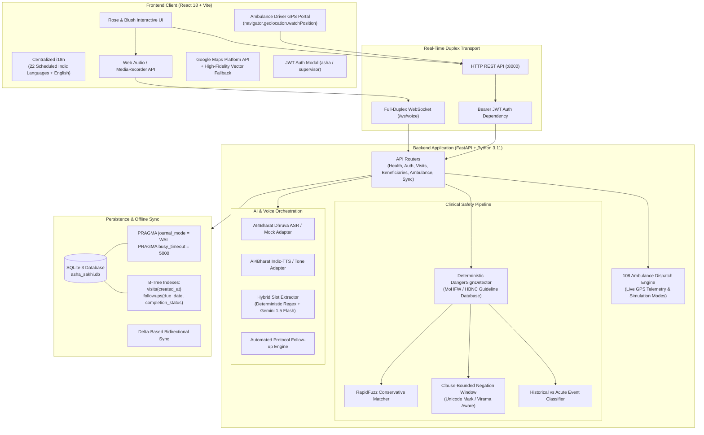

# 🌸 ASHA Sakhi (ಆಶಾ ಸಖಿ)
### AI-Powered Multilingual Voice Field Register & Clinical Decision Support for Rural Health Workers

[](https://github.com/ashasakhi/asha-sakhi/actions/workflows/test.yml)
[](https://fastapi.tiangolo.com)
[](https://react.dev)
[](https://vitejs.dev)
[](https://www.sqlite.org)
[](https://www.python.org)
[](https://opensource.org/licenses/MIT)

---

## 📌 Problem Statement

In rural India, over **1 million Accredited Social Health Activists (ASHAs)** serve as the critical frontline healthcare link for 800+ million citizens across 600,000 villages. Every day, ASHAs walk door-to-door conducting Antenatal Care (ANC), Postnatal Care (PNC), Child Immunization, and Home-Based Newborn Care (HBNC) checks.

### The Pain Points:
1. **Administrative Burden & Burnout:** ASHAs spend **30% to 40% of their working hours** manually maintaining up to 14 separate paper registers, cross-referencing immunization schedules, and filing manual reports.
2. **Delayed Emergency Response:** Acute danger signs (antepartum haemorrhage, neonatal chest indrawing, eclampsia fits) are frequently buried in handwritten notes, delaying life-saving 108 ambulance dispatch and PHC escalation.
3. **Dialect & Literacy Barriers:** Most health technology portals enforce English or high-register standard state languages, alienating field workers who communicate in mixed colloquial dialects (Kannada, Tulu, Kannada-English code-mix, Hindi, etc.).
4. **Intermittent Connectivity:** Rural primary health centres often lack reliable cellular data, rendering cloud-only web applications unusable in the field.

### The Solution: ASHA Sakhi
**ASHA Sakhi** is a voice-first clinical field companion designed with and for frontline community health workers. It converts freeform spoken dialect into verified clinical records in seconds, executes **deterministic guideline-backed danger sign detection** with zero LLM hallucinations, triggers live GPS 108 ambulance tracking, automatically generates immunization follow-up tasks, and synchronizes seamlessly with an offline-first SQLite database.

---

## 🏗️ System Architecture



---

## ⏱️ 2-Minute Judge Demo Script

Follow this step-by-step walkthrough to test the core end-to-end features in under two minutes:

### 1. Login & Multilingual Language Switching (0:00 - 0:25)
1. Navigate to **http://localhost:5173**.
2. Click **Login** in the top navigation bar. Enter demo credentials:
   - **Username:** `asha`
   - **Password:** `password`
3. Click the **Language Selector** (globe icon) in the header. Select **Kannada (ಕನ್ನಡ)**, **Hindi (हिन्दी)**, or any of the **22 scheduled Indian languages**.
4. Observe that the entire UI—dashboard stats, navigation items, buttons, form placeholders, and emergency banners—updates instantly without page reload.

### 2. Spoken Voice Entry & Structured Extraction (0:25 - 0:55)
1. Click **Voice Assistant (ಧ್ವನಿ ಸಹಾಯಕ)** in the sidebar or click the floating microphone.
2. Select beneficiary **ಲಕ್ಷ್ಮಿ (Lakshmi - BEN-KA-001)**.
3. Speak or submit the test field utterance:
   > *"ಫಲಾನುಭವಿ ಲಕ್ಷ್ಮಿ BEN-KA-001, ANC checkup, weight 54 kg, TT injection done, BP normal, IFA goli given."*
4. Watch the streaming transcript extract structured clinical parameters:
   - **Visit Type:** ANC checkup
   - **Weight:** 54.0 kg
   - **Completed Vaccines:** TT injection
   - **Notes:** IFA goli given
5. Hear the automated spoken audio confirmation in Kannada: *"ಲಕ್ಷ್ಮಿ ಅವರ ಭೇಟಿ ದಾಖಲಿಸಲಾಗಿದೆ."*

### 3. MoHFW Clinical Danger Sign Interruption & Negation Safety (0:55 - 1:25)
1. **Trigger Acute Emergency:** Speak an acute obstetric or neonatal HBNC danger sign:
   > *"ಫಲಾನುಭವಿ ಸುಮಿತ್ರಾ, ಗರ್ಭಾವಸ್ಥೆಯಲ್ಲಿ ರಕ್ತಸ್ರಾವ ಆಗುತ್ತಿದೆ ತಕ್ಷಣ ನೋಡ್ಬೇಕು."*
   *(Or test newborn distress: "Newborn baby fast breathing and ede kusiyuttide severe respiratory distress.")*
2. **Instant Guideline Alert:** The screen immediately displays a flashing CRITICAL alert banner:
   - **Danger Sign:** `DNG-MAT-001` (Bleeding during pregnancy) / `DNG-NEO-003` (Newborn chest indrawing).
   - **Clinical Citation:** MoHFW Guidelines on Antenatal Care & HBNC Module 7.
   - **Spoken Action:** *"ಈ ಫಲಾನುಭವಿಗೆ ತಕ್ಷಣ PHC ಗೆ ರೆಫರ್ ಮಾಡಿ."* (Refer to PHC immediately).
3. **Verify Negation Handling (Zero False Alarms):**
   - Speak: *"ಲಕ್ಷ್ಮಿ ANC checkup, ಯಾವುದೇ ರಕ್ತಸ್ರಾವ ಇಲ್ಲ, ತೂಕ 54 kg, ಬಿಪಿ ನಾರ್ಮಲ್."*
   - Observe that **no emergency is raised**. The Kannada clause negation (`ಯಾವುದೇ ... ಇಲ್ಲ`) is recognized accurately.

### 4. 108 Ambulance Tracking & Live GPS Driver Portal (1:25 - 2:00)
1. Click **108 Ambulance (108 ಆಂಬ್ಯುಲೆನ್ಸ್)** in the navigation.
2. Observe active dispatch `AMB-SIM-001` with vehicle `KA-04-G-108`, driver **ರಮೇಶ್ (Ramesh)**, real-time distance (km), and road ETA (minutes).
3. Open the **Driver GPS Portal** (`/ambulance-driver`):
   - Click **Start Trip (ಪ್ರವಾಸ ಪ್ರಾರಂಭಿಸಿ)**.
   - The driver device streams real coordinates via `navigator.geolocation.watchPosition()`.
   - Toggle between **LIVE GPS MODE** and **DEMO SIMULATION MODE** to demonstrate live location streaming.
4. Open **Follow-ups & Reports (ಫಾಲೋ-ಅಪ್ ಗಳು)** to verify the automated task schedule for TT Booster and next ANC checkup.

---

## ⚖️ Judge-Facing Reference: "What is Mocked vs Real"

To ensure absolute transparency for hackathon evaluators and technical judges, here is the complete breakdown of every subsystem:

| Feature / Subsystem | Implementation Status | Technical Mechanism & Evidence |
| :--- | :---: | :--- |
| **Deterministic Danger Sign Engine** | **100% REAL** | No LLM hallucination risk. Evaluates 22 Indian languages against source-verified MoHFW & HBNC guidelines using RapidFuzz conservative matching, Unicode mark/virama-aware parsing, and clause-bounded negation windows (`backend/app/services/danger_detector.py`). |
| **Database & Concurrency** | **100% REAL** | SQLite3 operating in **WAL mode** (`PRAGMA journal_mode = WAL;`) with `busy_timeout = 5000ms`, foreign key constraints, B-tree indexes on `visits(created_at)` and `followups(due_date, completion_status)`, and transactional rollbacks (`backend/app/database.py`). |
| **JWT Authentication & Security** | **100% REAL** | `python-jose` HS256 JWT tokens. `POST /api/auth/login` issues Bearer tokens with role enforcement (`asha`, `supervisor`) on secured endpoints; restricted CORS headers (`backend/app/auth.py`). |
| **Centralized Multilingual Localization** | **100% REAL** | Zero untranslated pages. Complete translations across **all 22 scheduled Indian languages + English** in native scripts (Devanagari, Bengali, Gurmukhi, Gujarati, Odia, Tamil, Telugu, Kannada, Malayalam, Ol Chiki, Meetei Mayek, Arabic/Nastaliq) with RTL support (`frontend/src/context/LanguageContext.jsx`). |
| **108 Ambulance Dispatch & Driver GPS** | **100% REAL & HYBRID** | Uses HTML5 `navigator.geolocation.watchPosition()` on the driver device to broadcast live lat/lng coordinates to FastAPI backend and ASHA dashboard via WebSockets. Includes a clearly-badged **DEMO SIMULATION MODE** for evaluations without a secondary physical vehicle. |
| **Map Rendering** | **100% REAL & DUAL-LAYER** | Google Maps Platform JavaScript API with live road routes, markers, and polyline directions. Automatically switches to interactive vector terrain fallback if no API key is provided (`frontend/src/components/ambulance/GoogleAmbulanceMap.jsx`). |
| **Clinical Protocol Follow-up Engine** | **100% REAL** | Deterministic algorithm that computes exact due dates and priority tiers for ANC, PNC, TT immunization, IFA tablet distribution, and HBNC visits based on NHM operational manuals (`backend/app/services/followup_engine.py`). |
| **Speech Recognition (ASR)** | **HYBRID** | Implements real AI4Bharat Dhruva Multilingual ASR API client. Gracefully defaults to a clean mock/local transcription engine when `AI4BHARAT_API_KEY` is not provided (`backend/app/services/ai4bharat_asr.py`). |
| **Speech Synthesis (TTS)** | **HYBRID** | Implements real AI4Bharat Kannada Female Indic-TTS client. Defaults to browser Web Speech API / synthesized PCM WAV tone generation when operating offline without external credentials (`backend/app/services/ai4bharat_tts.py`). |
| **LLM Field Extraction** | **HYBRID** | Implements Google Gemini 1.5 Flash structured output extractor (`backend/app/services/llm_extractor.py`). Features a 100% offline deterministic regex & keyword slot extractor fallback (`backend/app/services/extractor.py`). |

---

## 🚀 Setup & Execution Guide

### Option A: One-Command Docker Setup (Recommended)

Run the entire containerized stack using Docker Compose:

```bash
# 1. Clone repository
git clone https://github.com/your-username/asha-sakhi.git
cd asha-sakhi

# 2. Launch backend service
docker compose up --build
```

- **Backend Health Check:** `http://localhost:8000/api/health`
- **Interactive Swagger Documentation:** `http://localhost:8000/docs`

---

### Option B: Local Development Setup

#### 1. Prerequisites
- **Python:** 3.11 or higher
- **Node.js:** 18.x or higher
- **Package Managers:** `pip` and `npm`

#### 2. Backend Setup
```bash
# Navigate to backend directory
cd backend

# Create and activate Python virtual environment
python -m venv venv
# On Windows:
.\venv\Scripts\activate
# On Linux / macOS:
source venv/bin/activate

# Install dependencies
pip install -r requirements.txt

# Run the FastAPI server
python -m uvicorn app.main:app --host 127.0.0.1 --port 8000 --reload
```

#### 3. Frontend Setup
In a new terminal:
```bash
# Navigate to frontend directory
cd frontend

# Install Node modules
npm install

# Start Vite development server
npm run dev
```

The frontend application will be live at **http://localhost:5173**.

---

## 🧪 Running Automated Tests

ASHA Sakhi includes a comprehensive unit and integration test suite covering danger sign detection, negation handling, ambulance telemetry, authentication, and database integrity.

```bash
# Run full pytest suite from repository root
python -m pytest backend/tests/

# Or run specific test modules:
python -m pytest backend/tests/test_danger_detector.py -v
python -m pytest backend/tests/test_auth.py -v
python -m pytest backend/tests/test_ambulance.py -v
python -m pytest backend/tests/test_api.py -v
```

---

## 📦 Environment Variables Reference

Copy `.env.example` to `.env` to customize settings:

```bash
cp .env.example .env
```

| Key | Default | Description |
| :--- | :--- | :--- |
| `VITE_GOOGLE_MAPS_API_KEY` | `""` | Optional Google Maps API key (enables satellite/street view). High-fidelity vector terrain map used if empty. |
| `HOST` | `0.0.0.0` | Backend bind host address. |
| `PORT` | `8000` | Backend API port. |
| `DATABASE_PATH` | `data/asha_sakhi.db` | Path to persistent SQLite database file. |
| `DATABASE_URL` | `sqlite:///./data/asha_sakhi.db` | SQLAlchemy / SQLite database connection URI. |
| `ASR_MODE` | `mock` | Speech recognition provider (`mock`, `ai4bharat_hosted`, `indic_transcribe_local`). |
| `TTS_MODE` | `mock` | Speech synthesis provider (`mock`, `ai4bharat_hosted`, `indic_tts_local`). |
| `EXTRACTION_MODE` | `auto` | Information extraction engine (`auto`, `deterministic`, `gemini`). |
| `GEMINI_API_KEY` | `""` | Optional Google Gemini API key for LLM-based extraction. |
| `AI4BHARAT_API_KEY` | `""` | Optional Bhashini / AI4Bharat Dhruva API key for cloud Indic speech. |

---

## 🛡️ Clinical Guidelines & Citations

The deterministic danger-sign detector and follow-up engine are built in strict compliance with published Government of India health manuals:
1. **MoHFW Guidelines for Antenatal Care and Skilled Attendance at Birth**, Maternal Health Division, Ministry of Health and Family Welfare, Government of India.
2. **MoHFW Home Based Newborn Care (HBNC) Operational Guidelines**, Child Health Division, Government of India.
3. **National Health Mission (NHM) High Risk Pregnancy Identification Protocols**, Ministry of Health and Family Welfare, GoI.
4. **MoHFW Operational Guidelines for Management of Postpartum Haemorrhage (PPH)**, Maternal Health Division, GoI.

---

## 👥 Contributors & Acknowledgements
- Built for healthcare equity by passionate engineers dedicated to empowering India's frontline ASHA workers.
- Special thanks to the **AI4Bharat / Bhashini** initiative by MeitY and IIT Madras for open Indic speech models.
- Licensed under the **MIT License**.
