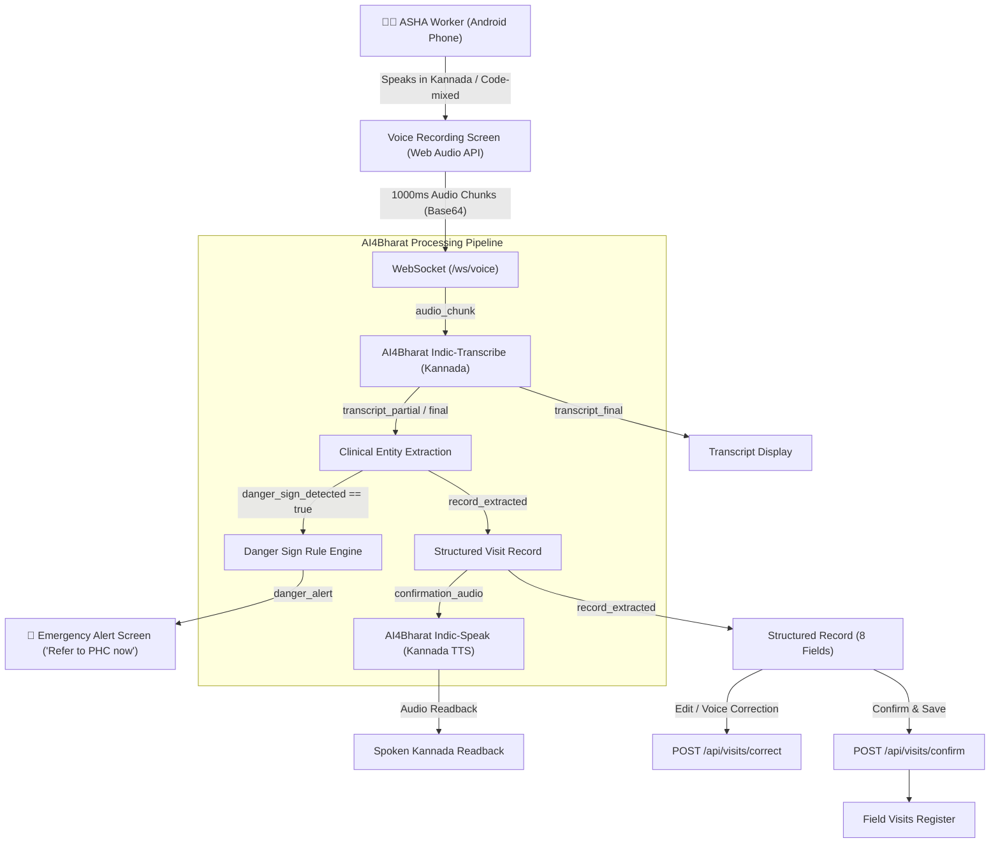

# ASHA ಧ್ವನಿ ಕ್ಷೇತ್ರ ದಿನಚರಿ | AI4Bharat-Powered Voice Field Register for ASHA Workers

A mobile-first, voice-first application designed for **Accredited Social Health Activists (ASHA)** in Karnataka, India. Enables community health workers to record beneficiary home visits, vitals, vaccinations, and follow-ups in **Kannada (with mixed English medical terms)** without manual typing, powered by **AI4Bharat Indic-Transcribe** and **Indic-Speak**.

---

## 🌟 Key Capabilities

1. **Voice-First Visit Recording**:
   - High-contrast, large touch-friendly microphone interface designed for ordinary Android smartphones.
   - Real-time Web Audio API waveform visualization.
   - Windowed audio chunking (1000ms buffers) matching AI4Bharat Indic-Transcribe batch windowing.
   - Support for partial transcript streaming events and final transcript generation.

2. **Structured Clinical Extraction (8 Core Fields)**:
   - Beneficiary ID & Beneficiary Name
   - Visit Type (ANC, PNC, Immunization, NCD)
   - Weight (kg)
   - Vaccinations Due & Completed
   - Next Visit Date
   - Additional Notes
   - Inline field editing & targeted **Voice Correction** (`correct_field` event).
   - Spoken readback in Kannada (AI4Bharat Indic-Speak) with instant interruption support (`interrupt_audio`).

3. **Prominent Emergency Danger Sign Alerts**:
   - Instant visual red alert (`#DC2626`) triggered when verified danger signs are detected (e.g. severe headache + blurred vision, severe facial/pedal edema, reduced fetal movements).
   - Strict adherence to WHO/NHM guidelines: **Zero diagnosis or treatment recommendations**; displays only detected danger signs, referral status, and clear instruction: **"Refer to PHC now" / "ತಕ್ಷಣ ಸಮೀಪದ ಪ್ರಾಥಮಿಕ ಆರೋಗ್ಯ ಕೇಂದ್ರಕ್ಕೆ (PHC) ಕರೆದೊಯ್ಯಿರಿ"**.
   - One-tap quick actions: Call 108 Ambulance, Contact PHC Medical Officer, Log Transport.

4. **Offline-First PWA Support**:
   - Progressive Web App (`manifest.json` and service worker `sw.js`).
   - LocalStorage and IndexedDB caching for offline rural field operations.
   - Built-in Mock/Demo Mode for standalone hackathon demonstrations without backend dependencies.

---

## 🛠️ Technology Stack

| Layer | Technology |
|---|---|
| **Framework** | React 18 (Vite 5) |
| **Language** | JavaScript (ESM, JSX) |
| **Styling** | Tailwind CSS 3 (Theme: White, Teal `#0D9488`, Emerald, Navy `#0F172A`, Red reserved for Emergency `#DC2626`) |
| **Typography** | Noto Sans Kannada, Baloo Tamma 2, System UI |
| **Audio Processing** | Web Audio API (`AudioContext`, `AnalyserNode`), `MediaRecorder` |
| **Audio Constraints** | `echoCancellation: true`, `noiseSuppression: true`, `autoGainControl: true`, `sampleRate: 16000` |
| **Networking** | Fetch API with timeout & WebSocket (`/ws/voice`) |
| **Offline / PWA** | Service Worker, Cache API, Web App Manifest |

---

## 📱 Architecture & Workflow



---

## 🔌 API & Event Specification

### REST Endpoints

| Method | Endpoint | Description |
|---|---|---|
| `GET` | `/api/health` | Backend and AI4Bharat inference service status |
| `GET` | `/api/beneficiaries` | List of registered beneficiaries in the PHC sector |
| `GET` | `/api/visits` | List of completed and saved visit records |
| `GET` | `/api/followups` | Follow-up schedule (Pending, Upcoming, Missed) |
| `POST` | `/api/visits/confirm` | Confirm and persist extracted visit record |
| `POST` | `/api/visits/correct` | Apply single-field correction to visit record |

### WebSocket Protocol (`/ws/voice`)

#### Client ➡️ Server Events
```json
// 1. start_session
{
  "event": "start_session",
  "session_id": "SES-102941",
  "language": "kn", // "kn" | "kn-en" | "en"
  "audio_config": {
    "sample_rate": 16000,
    "encoding": "audio/webm",
    "channels": 1
  }
}

// 2. audio_chunk
{
  "event": "audio_chunk",
  "session_id": "SES-102941",
  "chunk_index": 1,
  "audio_data": "<base64_encoded_audio>",
  "size_bytes": 16384,
  "format": "audio/webm"
}

// 3. stop_recording
{
  "event": "stop_recording",
  "session_id": "SES-102941"
}

// 4. confirm_record
{
  "event": "confirm_record",
  "session_id": "SES-102941",
  "visit_record": {
    "beneficiary_id": "ASHA-KA-2024-0101",
    "beneficiary_name": "Lakshmamma K.",
    "visit_type": "ANC (Antenatal Care)",
    "weight": "58.5",
    "vaccinations_due": "None",
    "vaccinations_completed": "TT-2 / TD-2 Booster",
    "next_visit_date": "2026-12-05",
    "additional_notes": "BP normal. Good fetal movement."
  }
}

// 5. correct_field
{
  "event": "correct_field",
  "session_id": "SES-102941",
  "field_name": "weight",
  "new_value": "59.0",
  "correction_text": "ತೂಕ ಐವತ್ತೊಂಬತ್ತು ಕೆಜಿ",
  "correction_audio": null
}

// 6. interrupt_audio
{
  "event": "interrupt_audio",
  "session_id": "SES-102941"
}
```

#### Server ➡️ Client Events
- `session_started`: Negotiated audio format & model metadata.
- `transcript_partial`: Emitted when an audio window is processed by Indic-Transcribe.
- `transcript_final`: Complete transcribed speech in Kannada/Code-mixed.
- `record_extracted`: Extracted 8 structured fields.
- `record_updated`: Confirmation of field update.
- `confirmation_audio`: Spoken readback audio URL / base64 for Indic-Speak.
- `danger_alert`: Triggered when verified danger signs detected.
- `visit_saved`: Final visit ID confirmation.
- `error`: Error details and code.

---

## 🚀 Getting Started

### Prerequisites
- Node.js 18+ or 20+
- npm 9+

### Installation & Run

```bash
# Navigate to frontend folder
cd frontend

# Install dependencies
npm install

# Start development server
npm run dev
```

Visit `http://localhost:5173` in your browser. Open DevTools in **Responsive Device Mode** (e.g., Pixel 7 or Galaxy S20, 390x844px) to experience the mobile-first UI.

### Configuration (`.env`)

```env
# Backend REST and WebSocket URLs
VITE_API_BASE_URL=http://localhost:8000
VITE_WS_URL=ws://localhost:8000/ws/voice

# Set to true for standalone hackathon demo mode (works without backend)
VITE_DEMO_MODE=true

# AI Model Labels
VITE_ASR_MODEL=AI4Bharat Indic-Transcribe (Kannada)
VITE_TTS_MODEL=AI4Bharat Indic-Speak (Kannada)
```

---

## 🧪 Demo Scenarios Guide

When **Demo Mode** is active (top navbar pill says `Demo Mode`), select any of the 3 realistic healthcare scenarios from the dropdown on the Voice Recording screen:

1. **ANC Routine Checkup (Lakshmamma K.)**:
   - Simulates Kannada home visit transcription: *"ಲಕ್ಷ್ಮಮ್ಮ ಅವರ ಮನೆಗೆ ಭೇಟಿ ನೀಡಲಾಗಿದೆ. ಗರ್ಭಿಣಿ ತಪಾಸಣೆ. ತೂಕ 58.5 kg ಇದೆ..."*
   - Extracts weight, TT-2 vaccination, normal BP, next visit date.
   - Triggers spoken readback in Kannada.

2. **⚠️ Emergency Danger Sign (Geetha M.)**:
   - Simulates speech with danger signs: *"ಗೀತಾ ಅವರಿಗೆ ತೀವ್ರ ತಲೆನೋವು ಮತ್ತು ಕಣ್ಣು ಮಬ್ಬು (severe headache and blurred vision) ಇದೆ..."*
   - Triggers the **Prominent Red Emergency Alert Screen**.
   - Displays referral instruction: **"Refer to PHC now"**, one-tap **Call 108 Ambulance** button.

3. **PNC & Infant Immunization (Shruthi Patel & Baby Aarav)**:
   - 6-month checkup, baby weight 7.2 kg, OPV-3 & Pentavalent-3 administration.
